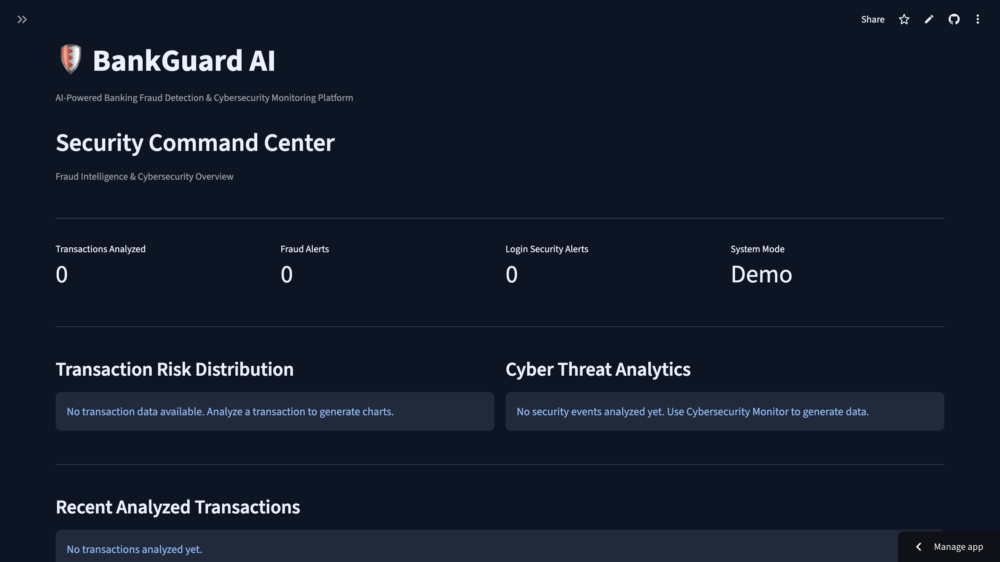
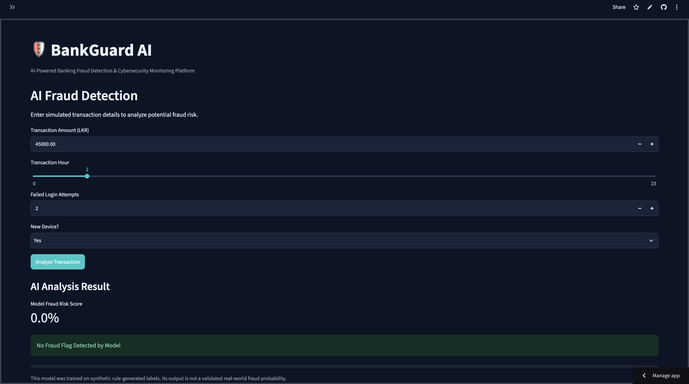
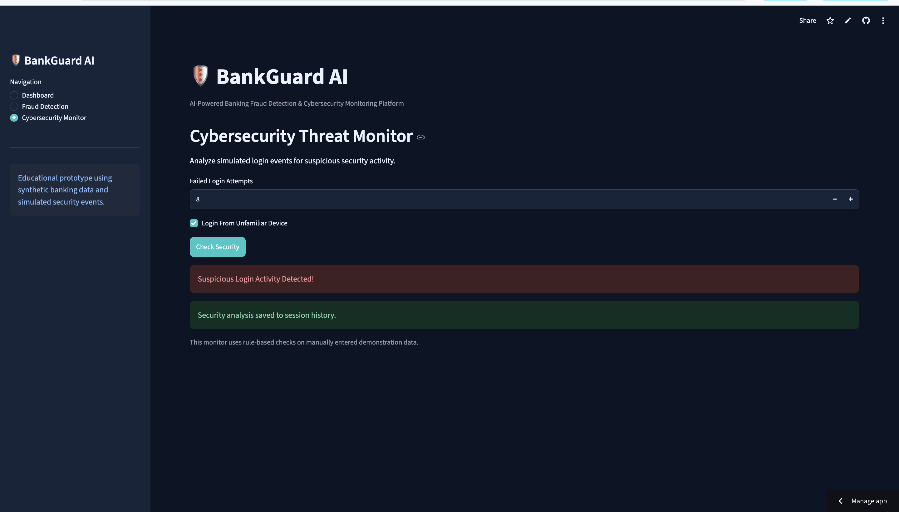

# 🛡️ BankGuard AI

### AI-Powered Banking Fraud Detection & Cybersecurity Monitoring Platform

BankGuard AI is a web-based educational prototype
that combines machine learning fraud risk classification,
rule-based cybersecurity monitoring, and interactive
security analytics.

The application demonstrates how transaction risk
and suspicious login behavior can be analyzed
within a single banking security dashboard.

## 🌐 Live Demo

https://bankguard-ai-samoshi574.streamlit.app


## 📸 Application Screenshots

### 🛡️ Security Command Center


### 🤖 AI Fraud Detection


### 🔐 Cybersecurity Threat Monitor


## ✨ Features

### AI Fraud Detection
- Random Forest machine learning classifier
- Transaction amount and time analysis
- Failed-login and device-risk features
- Model-based risk scoring
- Rule-based risk indicators

### Cybersecurity Monitor
- Suspicious login attempt detection
- Unfamiliar device monitoring
- Security risk classification
- Session-based security event history

### Security Dashboard
- Dynamic transaction statistics
- Fraud alert counter
- Login security alert counter
- Interactive risk distribution charts
- Cybersecurity analytics
- Transaction and security event history
- Transaction history CSV export

## 🛠️ Technologies

- Python
- Streamlit
- Scikit-learn
- Pandas
- NumPy
- Plotly
- Joblib
- Git & GitHub
- Streamlit Community Cloud

## 🏗️ System Architecture

```text
User / Security Analyst
         |
         v
Streamlit Web Interface
         |
         +--------------------------+
         |                          |
         v                          v
Fraud Detection              Cybersecurity Monitor
         |                          |
         v                          v
Random Forest Model           Rule-Based Checks
         |                          |
         +------------+-------------+
                      |
                      v
             Streamlit Session State
                      |
                      v
             Security Dashboard
                      |
                      v
             Charts / Alerts / CSV
```

## 🤖 Machine Learning

Algorithm: Random Forest Classifier

Input features:
- Transaction amount
- Transaction hour
- Failed login attempts
- New device indicator

Training data:
- 3,000 synthetic transactions
- Labels generated using predefined rules

Important:
The model learns patterns based on synthetic rule-generated
labels. Its score is not a calibrated probability of
real-world banking fraud.

## 🚀 Installation

Clone the repository:

```bash
git clone https://github.com/Samoshi574/-BankGuard-AI.git
cd -- -BankGuard-AI
```

Create a virtual environment:

```bash
python3 -m venv .venv
source .venv/bin/activate
```

Install dependencies:

```bash
python -m pip install -r requirements.txt
```

Run the application:

```bash
python -m streamlit run app.py
```

## 🔐 Security & Limitations

- No real banking data is used.
- No connection to real banking systems.
- Cybersecurity detection uses predefined rules.
- Transaction history is session-based, not permanent.
- Dashboard results are for demonstration purposes.
- The project is not production-ready banking software.

## 🎯 Future Improvements

- Persistent PostgreSQL database
- User authentication and role-based access control
- Realistic fraud datasets and validated models
- Explainable AI using SHAP
- Graph-based fraud investigation
- Automated testing and CI/CD

## 👩‍💻 Developer

Samoshi574

Software Engineering Portfolio Project
